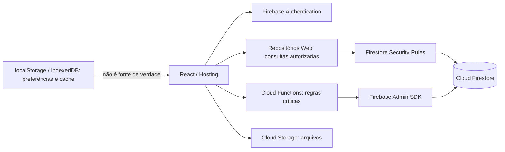

# Arquitetura de persistência SHARKSET

## Diretriz

Firebase Authentication identifica usuários; Firestore guarda registros estruturados; Cloud Functions/Admin SDK valida operações de negócio privilegiadas. O cliente pode ler e editar somente dados explicitamente autorizados por regras. Arquivos binários compartilhados devem usar Cloud Storage, com referência e metadados no Firestore. `localStorage`/IndexedDB ficam restritos a preferências e cache offline.

## Fluxo alvo

1. Auth retorna o UID, que vincula perfil e registros; email e nome são atributos mutáveis, não chaves.
2. Tela chama repositório tipado ou endpoint de domínio, sem escrever estado de negócio somente em cache.
3. Regras do Firestore validam proprietário/arena e formato para CRUD simples; resultados, ranking, reservas e papéis privilegiados devem ser validados no servidor.
4. UI informa sucesso após confirmação persistente e apresenta erro acionável quando a gravação falhar.
5. Leitura em outro dispositivo consulta Firestore; o cache offline só acelera leitura e reconcilia mudanças pendentes.

## Estado atual e lacunas

Hosting é SPA estática. `server.ts` não está conectado como serviço de produção no `firebase.json`; as únicas Cloud Functions declaradas são LiveKit. Portanto, qualquer regra de domínio que dependa de Admin SDK ainda precisa de um endpoint Cloud Function implantável antes de ser considerada segura em produção.

Não há configuração de Cloud Storage, índices versionados ou ambiente staging declarado. Backups, PITR e custos não foram alterados nem auditados nesta etapa.
