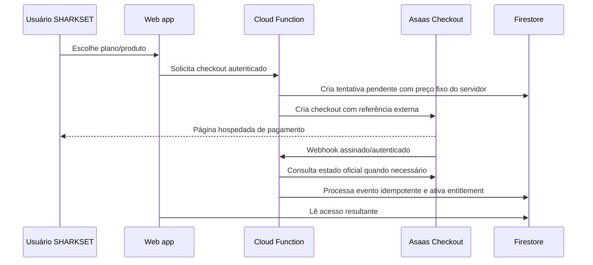

# Planos e pagamentos SHARKSET

## Preços solicitados

| Produto | Preço | Ciclo | Regra de habilitação |
| --- | ---: | --- | --- |
| Arena Essencial | R$ 99,90 | Recorrente mensal | Até 2 quadras cadastradas |
| Arena Ilimitada | R$ 149,90 | Recorrente mensal | Sem limite de quadras |
| Campeonato | R$ 19,90 | Cobrança única | Qualquer usuário autenticado pode criar depois da confirmação do pagamento |

O checkout está bloqueado na interface até configurar o recebedor, credenciais de servidor e webhooks. A página de retorno do provedor não confirma pagamento.

## Experiência de pagamento PIX solicitada

O fluxo da primeira versão deve ser direto: a pessoa escolhe o plano, toca em **Gerar PIX**, vê o QR Code e o código copia e cola, toca em **Copiar PIX** e paga no banco. A tela fica em `Aguardando pagamento` e muda para `Pago` somente após o backend receber e validar o evento `PAYMENT_RECEIVED` do Asaas. Copiar o código, voltar à página ou anexar comprovante não confirma a transação.

- **Campeonato (R$ 19,90):** cobrança PIX avulsa. O evento confirmado libera a criação do campeonato vinculado àquela cobrança.
- **Arena (R$ 99,90 ou R$ 149,90 por mês):** assinatura mensal com cobranças PIX recorrentes. A cada ciclo o provedor gera uma nova cobrança; a arena precisa pagar o PIX daquele mês para manter/renovar o acesso, salvo se for habilitado PIX Automático.
- **PIX Automático:** pode reduzir a ação mensal para uma autorização inicial no banco e cobranças futuras automáticas, mas exige consentimento/autorização bancária do pagador e disponibilidade para a conta. Tratar isso como uma opção separada, sem presumir que um PIX copia e cola autoriza débitos futuros.

Asaas documenta a criação de cobrança PIX e a obtenção do QR Code/código copia e cola ([criar cobrança](https://docs.asaas.com/reference/create-new-payment), [QR Code PIX](https://docs.asaas.com/reference/get-qr-code-for-pix-payments), [guia PIX](https://docs.asaas.com/docs/payments-via-pix-or-dynamic-qr-code)). A confirmação deve usar o evento de pagamento recebido e a chave do evento para idempotência, pois webhooks podem ser reenviados ([idempotência](https://docs.asaas.com/docs/how-to-implement-idempotence-in-webhooks), [webhooks](https://docs.asaas.com/docs/webhooks-1)).

## Provedor recomendado para primeira versão: Asaas

Recomendação inicial por oferecer uma página hospedada de checkout, cobrança avulsa e recorrente em API, além de eventos de webhook para sincronização. Usar checkout hospedado mantém os dados de cartão fora do navegador SHARKSET. As tarifas e o prazo de recebimento devem ser conferidos na conta Sharkset antes de decidir os métodos habilitados.

Fontes oficiais:

- [API de criação de checkout Asaas](https://docs.asaas.com/reference/criar-novo-checkout)
- [Criando uma assinatura Asaas](https://docs.asaas.com/docs/criando-uma-assinatura)
- [Webhooks e eventos Asaas](https://docs.asaas.com/docs/webhooks-e-eventos)
- [Visão geral Asaas](https://docs.asaas.com/docs/visao-geral)

O Mercado Pago é uma alternativa viável, especialmente se já existir conta Sharkset ativa. Oferece API de assinaturas e Checkout Pro. Para iniciar uma integração nova, consultar a documentação atual do [Checkout Pro via Orders](https://www.mercadopago.com.br/developers/pt/reference/online-payments/checkout-pro-orders/overview) e da [API de assinaturas](https://www.mercadopago.com.br/developers/pt/reference/online-payments/subscriptions/overview). Comparar taxas, métodos, prazo de recebimento, política de contestação e disponibilidade de recorrência para os métodos desejados diretamente no painel da conta.

## Arquitetura de cobrança

### Regras obrigatórias

- Preço, ciclo, produto, usuário e arena são calculados/validados no backend. Nunca aceitar preço do browser como autoridade.
- Credenciais privadas e token do webhook ficam no Secret Manager e só são lidos pela Function de cobrança.
- Cada pedido interno tem ID aleatório, UID, tipo de produto, valor em centavos, estado pendente, expiração e IDs do provedor. Não guardar PAN/CVV.
- Retorno do checkout só exibe “verificando pagamento”. Liberação ocorre após webhook validado e, se necessário, consulta ao provedor.
- Webhooks podem ser repetidos ou chegar fora de ordem. Persistir o ID do evento, validar estado/valor/referência e aplicar a transição uma única vez.
- Reembolso, chargeback, falha de renovação, cancelamento e período de tolerância têm transições explícitas; nenhum botão do cliente muda o estado financeiro.
- Exclusão/limite de quadras segue o plano ativo validado no servidor; regras e consultas também precisam aplicar o limite.
- Pagamento de campeonato é único e libera somente a criação associada à referência paga. A criação do campeonato deve preservar as regras oficiais atuais.

## O que configurar na conta do Sharkset

1. Criar/validar conta de vendedor em nome da pessoa jurídica que receberá a receita. Confirmar titularidade, documentos, conta de liquidação e dados fiscais com contador/responsável legal.
2. Criar ambiente sandbox e a aplicação de API no provedor. Criar produtos/preços de teste e validar cobrança recorrente e cobrança avulsa.
3. Em produção, configurar a conta recebedora, emitir credencial privada e token secreto de autenticação/assinatura dos webhooks.
4. Guardar segredos em Secret Manager no projeto `sharkset-70de4`; conceder acesso mínimo só à Function de pagamentos. Nunca colocar segredo `VITE_*`, no Firestore legível pelo cliente ou no Git.
5. Implantar primeiro em staging após aprovação, cadastrar URL HTTPS de webhook, eventos mínimos de checkout, pagamento, recorrência, falha, cancelamento, estorno/chargeback e verificar eventos simulados.
6. Rodar uma transação real de baixo valor somente depois da aprovação final; conferir extrato, taxa líquida, conciliação, cancelamento/reembolso e ativação/desativação de acesso.

Não foi criada conta, chave, produto, webhook, IAM ou configuração de produção nesta etapa.

## Decisões de produto ainda necessárias

- Dia da cobrança mensal e regra de proporcionalidade no primeiro mês.
- Prazo de tolerância após falha de renovação antes de suspender funcionalidades.
- Se upgrade de 2 para 3 quadras é imediato e como tratar proporcionalidade; downgrade e remoção de quadras.
- Política de cancelamento, reembolso, chargeback, renovação e aviso ao cliente.
- Quem emite nota fiscal/recibo e qual entidade aparece como vendedor.
- Se campeonatos são pagos antes de iniciar cadastro ou se há rascunho temporário com expiração.
- Como comprovar que “qualquer usuário” está autenticado e evitar criação de campeonato órfão.

## Plano de validação antes de produção

Testar no Sandbox: checkout avulso pago, pendente, expirado e cancelado; assinatura aprovada, renovação, falha, pausa e cancelamento; webhook duplicado, sem token, valor divergente, referência inexistente e fora de ordem; tentativa cliente de alterar preço/owner/plan; reenvio do mesmo evento; indisponibilidade do provedor; conferência de cancelamento, estorno e perda de acesso. Fazer reconciliação diária pelo provedor como defesa contra webhooks perdidos.
